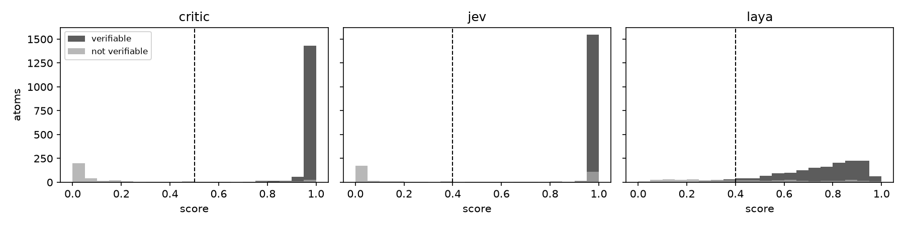

# LLMAtomizer vs SpanAtomizer

`LLMAtomizer` (openai:gpt-6-luna, the default prompt) vs `SpanAtomizer` (atomizer-gliner-small v0.5, its defaults). Written by scripts/compare_atomizers.py.

## Atomization

| Set | Atomizer | Texts | Claims / text (ref) | Claims / sentence | Token P / R / F1 | Embedding P / R / F1 | Exact F1 | Invented words | Atoms with a new number or name | Resolved | Wrong refs | ms / text p50 (p90) | $ / 1k texts |
|---|---|---|---|---|---|---|---|---|---|---|---|---|---|
| factcheckbench | llm | 30 | 8.6 (7.6) | 2.65 | 0.780 / 0.813 / **0.796** | 0.913 / 0.932 / **0.922** | 0.252 | 3.17% | 0.0% | – | – | 2312 (3097) | 0.21 |
| factcheckbench | span | 30 | 6.6 (7.6) | 2.04 | 0.763 / 0.744 / **0.753** | 0.878 / 0.879 / **0.879** | 0.146 | 0.00% | 0.0% | – | 0.000 | 57 (101) | 0.00 |
| synthetic | llm | 323 | 5.9 (5.4) | 1.45 | 0.798 / 0.809 / **0.803** | 0.879 / 0.874 / **0.877** | 0.303 | 4.36% | 1.0% | – | – | 1795 (3469) | 0.18 |
| synthetic | span | 323 | 5.8 (5.4) | 1.41 | 0.900 / 0.911 / **0.905** | 0.928 / 0.937 / **0.932** | 0.555 | 0.00% | 0.1% | – | 0.012 | 34 (93) | 0.00 |
| decontext | llm | 195 | 3.2 (1.0) | 2.96 | 0.487 / 0.632 / **0.550** | 0.793 / 0.863 / **0.826** | 0.017 | 4.96% | 1.1% | 0.816 | – | 2335 (3511) | 0.24 |
| decontext | span | 195 | 3.2 (1.0) | 3.03 | 0.466 / 0.674 / **0.551** | 0.684 / 0.876 / **0.768** | 0.041 | 0.05% | 0.3% | 0.703 | 0.073 | 51 (91) | 0.00 |
| propsegment | llm | 500 | 2.8 (3.9) | 2.70 | 0.746 / 0.700 / **0.722** | 0.882 / 0.845 / **0.863** | 0.098 | 8.39% | 6.1% | – | – | 1562 (2219) | 0.13 |
| propsegment | span | 500 | 2.5 (3.9) | 2.43 | 0.805 / 0.714 / **0.757** | 0.868 / 0.808 / **0.837** | 0.148 | 0.00% | 0.1% | – | 0.048 | 34 (51) | 0.00 |
| propositionizer | llm | 500 | 8.8 (7.5) | 1.57 | 0.700 / 0.696 / **0.698** | 0.855 / 0.845 / **0.850** | 0.097 | 5.27% | 2.5% | – | – | 2426 (4356) | 0.26 |
| propositionizer | span | 500 | 6.2 (7.5) | 1.12 | 0.795 / 0.697 / **0.742** | 0.876 / 0.816 / **0.845** | 0.175 | 0.00% | 0.2% | – | 0.054 | 67 (131) | 0.00 |

## Critic vs claim filters (human-labelled atoms: verifiable or not)

| Set | Atoms (verifiable) | Scorer | AUC | F1 at its cut-off | Best F1 (cut-off) |
|---|---|---|---|---|---|
| claim_cases | 19 (10) | critic | 1.000 | 1.000 (at 0.5) | 1.000 (0.95) |
| claim_cases | 19 (10) | jev | 1.000 | 1.000 (at 0.4) | 1.000 (0.95) |
| claim_cases | 19 (10) | laya | 1.000 | 0.909 (at 0.4) | 1.000 (0.70) |
| factcheckbench | 227 (221) | critic | 0.776 | 0.966 (at 0.5) | 0.987 (0.15) |
| factcheckbench | 227 (221) | jev | 0.797 | 0.987 (at 0.4) | 0.989 (0.60) |
| factcheckbench | 227 (221) | laya | 0.866 | 0.912 (at 0.4) | 0.987 (0.05) |
| synthetic | 1736 (1352) | critic | 0.980 | 0.966 (at 0.5) | 0.968 (0.75) |
| synthetic | 1736 (1352) | jev | 0.882 | 0.940 (at 0.4) | 0.952 (0.95) |
| synthetic | 1736 (1352) | laya | 0.801 | 0.914 (at 0.4) | 0.914 (0.40) |
| all | 1982 (1583) | critic | 0.975 | 0.966 (at 0.5) | 0.966 (0.55) |
| all | 1982 (1583) | jev | 0.881 | 0.947 (at 0.4) | 0.955 (0.85) |
| all | 1982 (1583) | laya | 0.792 | 0.914 (at 0.4) | 0.917 (0.35) |

Agreement on keep / drop at each scorer's cut-off (all labelled atoms):

- critic vs jev: 93.9%
- critic vs laya: 87.9%
- jev vs laya: 91.0%

