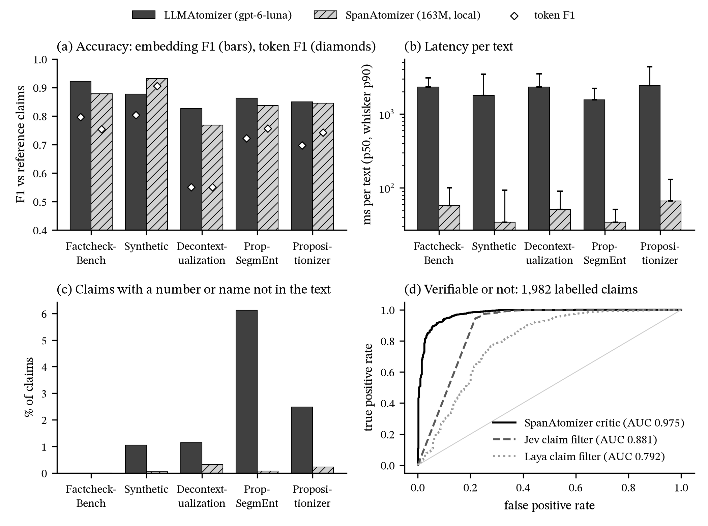
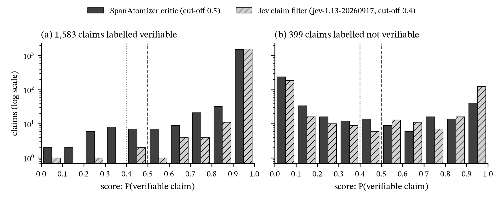

# Evaluations

Component benchmarks, each with its script and full tables. End-to-end accuracy runs (FactAssessor vs FactReasoner)
are in [issue #1](https://github.com/NISH1001/fact-assessor/issues/1); measured trade-offs behind the defaults are in
[design/decisions.md](design/decisions.md).

## End-to-end harness: `scripts/eval_atoms.py`

The product on a labelled long-form set: every labelled atom goes through `FactAssessor` (search, resolve, crawl,
judge; the claim filter runs on the atomizer's atoms for timing only, so every labelled atom gets a verdict) and is
scored with the SciELF paper's metric. This produced the FactReasoner comparison in issue #1 and every end-to-end
number in design/decisions.md since 2026-09-30. `uv run python scripts/eval_atoms.py --help` lists every flag.

**Data.** `tmp/scielf_paired.jsonl` (external, gitignored): pairs of an `original` and a `corrupted` long-form
answer, each with human-labelled atoms (`S` true, `NS` false); rows marked `is_synthetic` are skipped, leaving 50
pairs. Answers are named by the pair's position, `p000-original` / `p000-corrupted`, so `--limit N` (the first N
pairs, 2N answers) and `--sample N` (N random pairs, `--seed`) name the same answers as a full run.

**Modes.**

- `live`: the whole pipeline, with the atomizer writing `--source-queries` (2) per text. Every search is cached in
  `hits.json.gz` and every page the judge saw in `pages.json.gz`. Resumable: answers already in `results.json.gz` are
  skipped, so a run goes in batches by growing `--limit` with the same `--tag`, and a corrupted answer reuses its
  original's cached searches.
- `replay`: the cached evidence of `--tag`, judged again with another setup, written to `--out`. No network (free of
  Serper and AKD, minutes long; the judge's runner is the only cost). Knobs: `--passages`, `--passage-words`,
  `--pages-per-claim`, `--hit-order`, `--hits N` (first N hits of every query), `--source-hits N`,
  `--no-source-query`, `--judge`, `--strong`, `--strong-refute`; `--live-crawl` re-crawls live from the run's searches.
- `synth`: our own atoms (originals atomized, one-detail corruptions written by an LLM) through the product path;
  it measures atomization in the loop and is not comparable to the paper's table.
- `report --tag`: the table and timings of a run.

**Output.** `tmp/eval_atoms/<tag>/`: `hits.json.gz`, `pages.json.gz`, `results.json.gz` (per answer: its atoms with
verdict, label, error and per-component times) and `meta.json` (when, commit, argv and every argument; appended per
invocation, so a batched run lists each batch). The table is per-answer accuracy, precision, recall and F1 with S as
the positive class, macro-averaged over answers, on the corrupted split and on original + corrupted combined;
`supported` counts as S, every other verdict as NS; the paper's Table 3 row (web, combined F1 0.731) is printed for
reference. Then verdict counts, false atoms caught, timeouts, per-claim component percentiles, and per-answer times
for the originals whose searches were live. Every live run records each claim's seconds per component (search wait,
search, snippet judging, resolve, crawl, page judging, total): a slow run is explained from `results.json.gz`.

**Judges and keys.** `--judge laya` (the flag's default; local), `decision` (Jev on ZenMux through System One, `ZENMUX_API_KEY`; OpenRouter: see the README's "Jev on OpenRouter";
`--judge-model`, default `typesafe/jev-1.14`: pass `typesafe/jev-1.13` for 1.13), `openai` (gpt-6-luna
through OpenAI's Decisions API: `OPENAI_API_KEY` only, no Jev anywhere), `llm` (a chat model, `--llm-model`). The
atomizer always needs `OPENAI_API_KEY`. `--searcher serper` needs `SERPER_API_KEY` (10 results = 1 credit, about
1,530 per full live run); `akd` needs `AKD_SCHOLAR_SEARCH_URL` / `AKD_SCHOLAR_SEARCH_API_KEY` (no credits, and the
index doesn't change between runs); `searxng` a local instance (small probes only: a full run gets it suspended).

**The flag defaults are not the library's**: `--passages 1`, `--passage-words 90`, `--overfetch 0`, `--timeout 15`
(live), `--judge laya`, `--hit-order original`. The measured setups pass theirs explicitly:

```bash
# the issue #1 baseline (2026-09-30, tag web-serper): Serper + Jev, 10 readable pages per claim, 3 windows per page
uv run python scripts/eval_atoms.py live --data tmp/scielf_paired.jsonl --tag web-serper --searcher serper \
  --overfetch 1.0 --passages 3 --timeout 42 --judge decision --parallel 6

# the same evidence judged by Jev 1.14 at 512-word windows (combined F1 0.834; 90 words 0.806)
uv run python scripts/eval_atoms.py replay --tag web-serper --out web-serper-j114-w512 --passage-words 512 \
  --passages 3 --pages-per-claim 10 --judge decision --judge-model typesafe/jev-1.14 --parallel 10

# AKD Scholar Search, full text from the index, cap 10 interleaved (0.810 on the clean subset, Serper 0.840 there)
uv run python scripts/eval_atoms.py live --data tmp/scielf_paired.jsonl --tag live-akd-top20-j114-w512-p10-il \
  --searcher akd --akd-top 20 --crawler akd-doi+web --pages-per-claim 10 --hit-order interleaved \
  --passages 3 --passage-words 512 --judge decision --judge-model typesafe/jev-1.14 --parallel 10
#   gpt-6-luna judging instead (OpenAI key only): --judge openai and no --judge-model
#   in batches: --limit 5 (10 answers) first, check the table, then --limit 10, 15, ... with the same --tag
#   (the AKD numbers of 2026-10-23/24 came from the top-10 live run `web-akd`, re-searched at top 20 by
#   tmp/eval_atoms/akd_top20.py and given /doi pages by backfill_doi.py --first, then replayed; this command
#   is the first-class way to produce that evidence now)

uv run python scripts/eval_atoms.py report --tag live-akd-top20-j114-w512-p10-il
```

**Cost and time, 100 answers.** Jev at 512 words x 3 windows: $3.2-3.7, 4-6 min for a replay, 6-10 min live at
`--parallel 10`; at 90 x 3 about $0.5. gpt-6-luna judging: about 2.4x Jev (about $9). Atomizer: about $0.03 per
live run. Jev runs on ZenMux (cost estimated from input tokens; ZenMux's dashboard shows the real spend). A
rejected or out-of-credit key stops the run with `InvalidAPIKeyError`, and it resumes by tag. The commands above
from before 2026-10-25 ran on OpenRouter, with its dated ids (`typesafe/jev-1.14-20261014`).
Compare setups on replays of the same evidence; a live run's number moves with the web.

**Recording.** Every run's numbers, flags and findings go in `tmp/eval_atoms/RESULTS-<date>.md` as they finish
(gitignored, on disk); a conclusion that changes a default goes in [design/decisions.md](design/decisions.md) with
its date, and comparisons against FactReasoner in issue #1 (chart style: the issue's latest comment). Latency traces
(N texts at once, a per-component timing table) come from `tmp/eval_atoms/akd_e2e.py`, kept next to the other
one-off scripts there (`akd_trace.py`, `backfill_doi.py`, `window_chart.py`).

## Atomizers: `LLMAtomizer` vs `SpanAtomizer` (2026-10-13)

`LLMAtomizer` (gpt-6-luna, the default prompt) against `SpanAtomizer` (our span model,
[atomizer-gliner-small](https://huggingface.co/nishparadox/atomizer-gliner-small) v0.5, its defaults), on the test
sets of the atomizer repo, scored with that package's own functions (`atomizer.metrics`). Full tables:
[data/results/atomizers.md](../data/results/atomizers.md). Script: `scripts/compare_atomizers.py`.

| Set | Texts | Reference |
|---|---|---|
| Factcheck-Bench test | 30 | human claims of real ChatGPT answers (closest to our input) |
| synthetic test | 323 | AI-written chat, agent and science texts, with per-atom labels |
| Decontextualization valid | 195 | one sentence of a paragraph, rewritten by a human to stand alone |
| PropSegmEnt test | 500 | human, sentence fragments |
| Propositionizer test | 500 | GPT-4 propositions of Wikipedia passages |

**In-distribution caveat:** the span model was trained on the train splits of the synthetic set, Factcheck-Bench and
Propositionizer (and its critic on the synthetic labels); the LLM is zero-shot on all of them. PropSegmEnt and
Decontextualization are the fairest sets.



### Atomization

Precision / recall match each claim to its most similar reference claim (and each reference claim to its most similar
prediction); **token** similarity is word overlap (it penalises paraphrase), **embedding** similarity is cosine of
all-MiniLM-L6-v2 (it forgives paraphrase). F1 shown; P / R in the full tables.

| Set | Claims / text: LLM · span (ref) | Token F1: LLM · span | Embedding F1: LLM · span | Invented words: LLM · span | New number or name: LLM · span |
|---|---|---|---|---|---|
| Factcheck-Bench | 8.6 · 6.6 (7.6) | **0.796** · 0.753 | **0.922** · 0.879 | 3.2% · 0 | 0.0% · 0.0% |
| synthetic | 5.9 · 5.8 (5.4) | 0.803 · **0.905** | 0.877 · **0.932** | 4.4% · 0 | 1.0% · 0.1% |
| Decontextualization | 3.2 · 3.2 (1.0) | 0.550 · 0.551 | **0.826** · 0.768 | 5.0% · 0.05% | 1.1% · 0.3% |
| PropSegmEnt | 2.8 · 2.5 (3.9) | 0.722 · **0.757** | **0.863** · 0.837 | 8.4% · 0 | 6.1% · 0.1% |
| Propositionizer | 8.8 · 6.2 (7.5) | 0.698 · **0.742** | 0.850 · 0.845 | 5.3% · 0 | 2.5% · 0.2% |

| | LLM | span |
|---|---|---|
| References resolved (Decontextualization) | **81.6%** | 70.3% |
| Wrong references (span: substituted name not in any reference claim) | – | 0–7.3% |
| ms per text, p50 (p90) | 1,562–2,426 (2,219–4,356) | **34–67 (51–131)** |
| $ per 1,000 texts | 0.13–0.26 | 0 |

- **Accuracy:** by word overlap the span model leads on 3 of 5 sets; once paraphrase is forgiven (embedding) the LLM
  leads on 3, ties one, and trails only on the synthetic set the span model was trained on. On Factcheck-Bench, the
  closest to real LLM answers, the LLM is ahead on both measures (0.922 vs 0.879 embedding F1).
- **Claims per text:** the span model writes fewer than the LLM, and below the reference on three sets (6.2 vs 7.5 on
  Propositionizer); the LLM writes more than the reference on Factcheck-Bench, synthetic and Propositionizer.
- **Hallucination:** the span model invents no words by construction (copied from the text, or closed-class glue).
  The LLM's invented words are mostly rewording, but 1–6% of its claims carry a number or name the text never states:
  on single sentences without context (PropSegmEnt) it fills names from world knowledge ("Bergevin" → "Marc
  Bergevin", "the studio" → "Studio Ghibli"). Mostly correct, but a claim the text never made, which then gets
  fact-checked. It also rewrites first person ("I'm tired" → "The speaker is tired").
- **References:** the LLM resolves more (81.6% vs 70.3%); the span model sometimes substitutes the wrong name (up to
  7.3% of its substitutions; in a spot check: "Hamm explains January Jones is torn").
- **Speed and cost:** the span model is ~35–50x faster per text and free; the whole LLM run (1,548 texts) cost $0.31.

### Critic vs the claim filters

The span model's critic (`verifiable`, `SpanAtomizer(min_verifiable=...)`) against `DecisionClaimFilter` on Jev (the
default; `~typesafe/jev-latest` on 2026-10-13, which was `typesafe/jev-1.13-20260917`) and on Laya, scoring the same 1,982 human-labelled atoms
(1,583 verifiable) one by one.

| Scorer | AUC | F1 at its cut-off | Best F1 (cut-off) | Cost |
|---|---|---|---|---|
| critic | **0.975** | **0.966** (0.5) | 0.966 (0.55) | local, in the atomizer's pass |
| Jev 1.13-20260917 | 0.881 | 0.947 (0.4) | 0.955 (0.85) | $0.034 for 1,982 atoms |
| Laya | 0.792 | 0.914 (0.4) | 0.917 (0.35) | local |

Agreement on keep / drop: critic–Jev 93.9%, critic–Laya 87.9%, Jev–Laya 91.0%.
Jev's model wasn't logged at scoring time; re-scoring 50 of the atoms with `typesafe/jev-1.13-20260917` gave the same
keep / drop on all 50 (mean score change 0.003), and with `typesafe/jev-1.14-20261014` one flip (mean change 0.012).



| At its default cut-off | Verifiable claims dropped (of 1,583) | Not verifiable kept (of 399) |
|---|---|---|
| critic (0.5) | 25 (1.6%) | **85** (21%) |
| Jev 1.13-20260917 (0.4) | **2** (0.1%) | 176 (44%) |
| Laya (0.4) | 78 (4.9%) | 206 (52%) |

- **The critic's scores are bimodal** (almost all near 0 or 1), as are Jev's; Laya's spread out. 0.5 is the critic's
  best cut-off within 0.05, so the threshold barely matters.
- **The errors differ in kind:** the critic removes more non-claims, but drops more real claims; Jev keeps almost
  every real claim and lets more non-claims through. A dropped claim is never checked; a kept non-claim costs a search.
- **The critic's lead is in-distribution:** 1,736 of the atoms are the synthetic set, whose train split trained the
  critic. On the 19 fact-assessor claim cases all three are perfect (AUC 1.0); Factcheck-Bench has only 6
  non-verifiable atoms (AUC unreliable). Jev's misses are mostly personal statements ("Slept like 4 hours") that the
  synthetic labels call not verifiable and Jev calls factual: a labelling convention as much as an error.
- **Out-of-distribution check still to do:** CheckThat! 2024 test (318 sentences, in the atomizer repo's
  `critic.jsonl`).

### Limitations

- **In-distribution:** the span model trained on 3 of the 5 sets' train splits, and its critic on the synthetic
  labels (88% of the critic's atoms). The LLM and Jev are zero-shot everywhere.
- **The references favour paraphrase:** Propositionizer's are GPT-4's, and the human ones are often reworded, so a
  model that copies the text's words is marked down on the embedding and token scores for wording, not meaning.
  Decontextualization's reference is one rewritten sentence, not atoms.
- **Embedding similarity is blind to wrong values:** "founded in 1958" and "founded in 1985" score near 1.
- **The labels are one convention:** the synthetic set calls personal statements ("Slept like 4 hours") not
  verifiable, which counts against Jev.
- **One run, no variance, no significance tests;** latency depends on hardware (span: a Mac, MPS) and the
  LLM provider's load.
- **No cut-off was tuned here:** both scorers use their defaults; one picked on these results would be post hoc.
- **Not end to end:** none of this says whether verdicts change. That needs the same answers through the full
  pipeline with each atomizer (`scripts/eval_atoms.py`), not yet run.

### Reproduce

```bash
W='--with "atomizer @ git+ssh://git@github.com/NISH1001/atomizer@v0.1.0" --with sentence-transformers'
uv run $W python scripts/compare_atomizers.py atomize            # both atomizers, cached in tmp/compare_atomizers/
uv run $W python scripts/compare_atomizers.py critic --laya      # critic, Jev, Laya on the labelled atoms
uv run $W python scripts/compare_atomizers.py report             # data/results/atomizers.{md,json} and the histogram
uv run $W python scripts/compare_atomizers.py figure             # docs/figures/atomizers.{png,pdf}
uv run $W python scripts/compare_atomizers.py distribution       # docs/figures/atomizers-scores.{png,pdf}
```

The test sets are read from a local atomizer checkout (`~/dev/nish/projects/atomizer/data/`).
